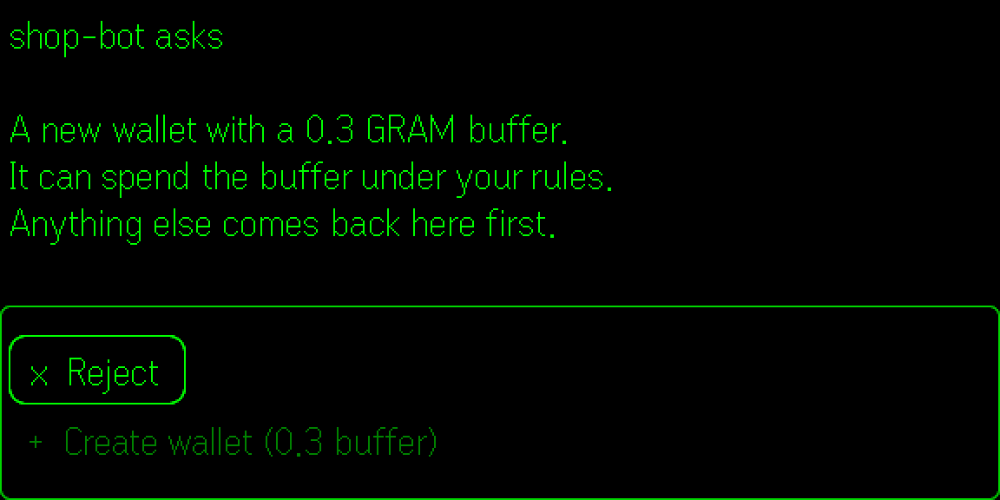
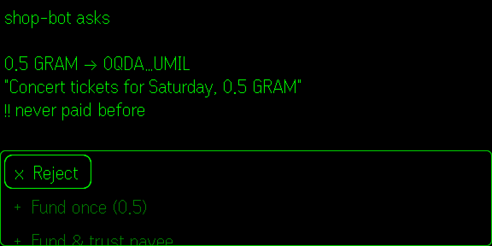
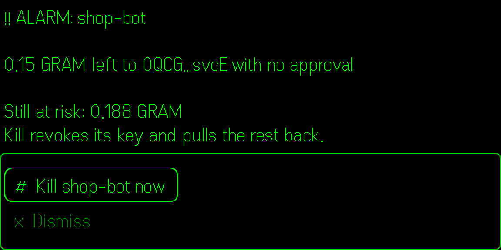

# Reins

**Your agents spend. You hold the reins.**

Reins is an Even G2 app that lets you approve, refuse and kill the AI agents that spend money for you on TON. Your agent asks for money and the request shows up on your glasses. Say "approve", or tap. Only the amount you approved ever reaches the agent's wallet.

**The moment it's for:** you're at dinner, walking, in a meeting. Your agent (OpenClaw, Hermes, Claude, anything) hits a payment. Today it either stalls until you pull out your phone, or it spends without asking. With Reins it's a two-second glance, and the agent keeps working.

Built for *Heads Up: Even Realities Hackathon* (TVM Ventures × Daos Hub).
Main track: **AI Assistants & Work** (OpenRouter, Claude via MCP). Second track: **Crypto & DeFi** (TON, Gram Wallet). Also entered for **Best Telegram integration**.

| Agent asks for a wallet | Agent asks to pay someone new | A hijacked agent spends on its own | One tap later |
|---|---|---|---|
|  |  |  |  |

These are captures of the real app in the Even Hub simulator, driving real TON testnet transactions.

---

## The problem

In April 2026 TON Tech shipped **Agentic Wallets**: an open standard that gives Telegram AI agents their own on-chain wallet. It is a big step, and it ships with a gap TON's own docs spell out:

- The contract has **no spending limits**. The docs' advice is "fund what you risk".
- There is **no approval or escalation flow**. If an agent "performs expensive transactions, it can spend the entire wallet balance before the owner reacts" (TON docs, FAQ).
- TON's agent toolkit tells agents to "confirm every transfer with the user before executing". Nothing enforces it. A prompt-injected agent just skips it.

So today the owner either over-funds the agent and hopes, or babysits a web dashboard. Neither works once agents run all day.

## What Reins does

1. **Drip funding.** Each agent wallet stays almost empty. When the agent needs money it asks, and you send exactly that amount. Your exposure is the one payment you approved, not the whole balance.
2. **Rules for the boring stuff.** Payees you trust, under their limit, are paid from a small buffer without bothering you. Everything else waits for you.
3. **Checks in plain code, not AI.** Reins flags new payees, lookalike addresses (address poisoning), amounts that don't match what the agent said, and limit breaches. No model decides whether money moves.
4. **Watchdog.** Every outgoing transfer from every agent wallet is matched against what you or your rules approved. Anything else raises an alarm on your lens.
5. **Kill switch.** One tap revokes the agent's key on chain and pulls its remaining balance back to your vault, in a single transaction.
6. **Hands-free.** When a request lands, Reins listens for a few seconds: "approve", "reject", "why", "kill it". From the home screen: "give trip-bot one more", "pause shop-bot". Speech is transcribed by a Whisper model on your own Reins server, so your voice never goes to a third party. Voice can only approve clean requests; anything flagged needs a tap.
7. **A home screen worth a glance.** Every agent with today's spend against its daily budget and its last payment. Open one to pause it, give it more for today, or kill it.
8. **Telegram, without your account.** A bot (bot token only, never your Telegram login) sends alerts and lets you Reject a request or Freeze an agent when the glasses app is closed. It cannot move money: that only happens from your glasses.

It uses TON's agentic wallet contract **unchanged**, so any agent built on the standard can use it.

## Proven on testnet

Everything above ran on TON testnet against the official agentic wallet collection (`EQByQ19q…fy07`):

- Vault: [`0QCMyK9E…dN3se`](https://testnet.tonviewer.com/0QCMyK9EmZw_NNQxlxbX3AkfWpKKSGIrQ3xNMWbASybdN3se)
- `trip-bot`: created, auto-paid a trusted payee, paid a new payee after approval, then was hijacked, caught and killed. [`kQAoy2GG…B3Eg`](https://testnet.tonviewer.com/kQAoy2GGAhr6py_oqyfEs_HEg2Xh-SxU_MlGsvpMKRh6B3Eg)
- `shop-bot`: created and funded from the lens, paid after a lens approval, hijacked, then killed with one tap on the lens. [`kQAN_8Sr…Asav`](https://testnet.tonviewer.com/kQAN_8Sr5QMnMa41KFwDZc-dZHJiMPkA3fxb2DoEYFdQAsav)

After each kill, `get_public_key` on the agent wallet returns `0`, its balance is `0`, and the stolen key's next payment is rejected by the network itself.

## How it works

```
 agent (LLM, Claude Code, Codex…)        your phone + G2                        TON testnet
 ───────────────────────────────         ─────────────────────────              ─────────────────────
 kit / reins-mcp                          Reins app (Even Hub WebView)
   holds the agent's operator key           holds the VAULT key (never leaves)
   pay(to, amount, purpose) ──┐                 ▲  card on the lens
                              ▼                 │  swipe · tap
                       Reins server ────────────┘
                         rules (code) · watchdog · Telegram bot
                              │  relays signed transactions only
                              └──────────────────────────────────────────────►  vault ──► agent wallet ──► payee
```

- The **vault** is a W5 wallet whose key is created on your phone and stored with the Even bridge. It is the owner of every agent wallet. The server never sees it.
- The **agent kit** holds the agent's operator key and only signs after the server says the payment was approved and the funds are there.
- The **server** applies the rules, keeps the queue for the lens, watches the chain and runs the Telegram bot. It only ever relays transactions that were signed elsewhere.

### Design choices worth noting

- **Smart defaults, safe where it matters.** A clean request to a payee you know opens with Approve selected: one tap. A flagged request opens with Reject first. The SDK drops zero values, so a tap on item 0 arrives with no index; putting Reject there means an ambiguous tap on a risky request refuses instead of paying. On an alarm, Kill is first.
- **Voice never approves a flagged payment.** Saying "approve" on a lookalike or mismatched request gets "This one is flagged. Tap to approve it." Kill and "give" always ask for a confirm, by voice or tap.
- **The speech model only transcribes.** Turning words into commands is plain code (`shared/intent.ts`), including sound-alike agent names: Whisper heard "tour bot" as "Turbah", and Reins still knew which agent you meant.
- **Double-tap always exits**, as Even's template requires. Nothing in Reins uses it.
- **Agent payments must use the `IGNORE_ERRORS` send mode.** The agentic wallet rejects anything else with exit code 137. We hit this in the first test; anyone building on the standard will.
- **The watchdog reads with toncenter v2.** The v3 indexer on testnet returned empty transaction lists for wallets that clearly had them, which would have made the watchdog blind.

## Run it

Needs Node 22. Everything is free: testnet GRAM from [@testgiver_ton_bot](https://t.me/testgiver_ton_bot), a free OpenRouter key, a Telegram bot from @BotFather.

```bash
git clone https://github.com/miracle352/reins && cd reins
npm install && (cd app && npm install)

# 1. server
cp .env.example .env        # add TELEGRAM_BOT_TOKEN (optional), TONCENTER_KEY (optional)
npm run server

# 2. glasses app in the simulator (or on G2 via the Even app)
cd app && npm run dev
npx evenhub-simulator http://localhost:5173
#  -> on the phone page: Create vault, then send testnet GRAM to it

# 3. an agent
OPENROUTER_API_KEY=... npx tsx demo/trip-agent.ts
```

### Use it from Claude Code or any MCP agent

```bash
claude mcp add reins -e REINS_AGENT_NAME=claude-agent -- npx tsx /path/to/reins/kit/src/mcp.ts
```

The agent gets `reins_connect`, `reins_wallet` and `reins_pay`. It never sees a key.

## Honest limits

- **Testnet only.** TON's agentic wallet is a developer preview and has not been audited.
- **The glasses are not a hardware wallet.** The lens is drawn by the phone, so a fully compromised phone could lie to it. Reins protects against a compromised *agent* or a compromised *dApp/proposer*, and caps the damage on chain either way.
- **The vault key is in plain Even app storage.** Even Hub has no secure storage API yet (see feature requests).
- **The app cannot alert you while it is closed** (an Even Hub rule). Requests wait for you, Telegram pings you, and drip funding means nothing big can happen meanwhile.
- **Self-hosted, single user.** One server per person for now.

## Feature requests for Even Hub

1. **Secure storage** (Keychain / Keystore backed) for keys and tokens. Today `setLocalStorage` is plain text.
2. **Alerts while an app is in the background**, even a single line, for safety-critical apps.
3. **A way to prove a frame came from a given app**, so users can trust what the lens shows.
4. **Scoped Telegram auth for Even Hub apps.** Some Telegram apps in this hackathon keep a full user session on their own server. A permission like "read chats X and Y, send only after a glasses tap" would be much safer.
5. **A list event that always includes the selected index**, instead of dropping it when it is 0.

## What existed before Nov 23

- Even Hub minimal template and SDK (Even Realities).
- TON agentic wallet contract and collection (TON Tech). The contract code BOC comes from `@ton/mcp` (MIT). Message builders in `shared/ton.ts` are written from the contract's message definitions.

Everything else in this repo was built during the hackathon.

## Roadmap

- Ship on the Even Hub catalogue, and as `reins-mcp` on npm.
- Mainnet, once TON's agentic wallet is audited, with the vault in Gram Wallet's split-key setup or a hardware signer.
- The same consent flow for Google's AP2 agent payments ("human present" purchases) and EVM agent wallets.
- A glanceable status line as soon as Even Hub supports background widgets.
